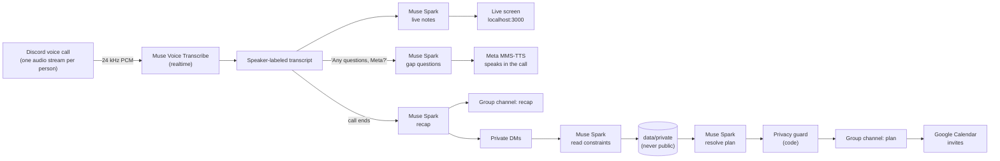

# 🪐 Orbit

**An AI social-planning copilot that listens to your group call and turns "idk, both sound fire" into a plan on everyone's calendar, without anyone having to say their budget or dietary needs in front of the group.**

Built for the Meta track *"Bringing People Closer Together with AI."* Every bit of AI in Orbit is Meta's: **Muse Voice Transcribe**, **Muse Spark**, and Meta's open-source **MMS-TTS** voice model.

> Discord stands in for Messenger/WhatsApp group calls, which don't offer APIs for this yet.

---

## What it does

1. **Join the call.** Two friends hop into a Discord voice channel and type `/join`. Orbit joins and posts a visible notice that it's listening and that anyone can `/pause` or `/stop`.
2. **Listen per person.** Discord gives Orbit a separate audio stream for each person, so **Muse Voice Transcribe** turns speech into a speaker-labeled transcript live.
3. **Live notes.** **Muse Spark** keeps running notes: who's free, what options are on the table, what's decided, and what's still open. Everything appears on a live screen, including Spark's reasoning as it thinks.
4. **"Any questions, Meta?"** Say it in the call and Orbit asks, out loud, *only* what the plan is still missing (an exact time, which option). It never asks about money or food in front of the group; instead it says it'll DM each person privately. The voice is Meta MMS-TTS.
5. **Recap.** When the call ends, Muse Spark writes a recap for the friend who was at work and @mentions them.
6. **Zero-ego check-ins.** Orbit DMs everyone privately: when you're free, your budget, dietary needs, which option you prefer. **Nobody has to state a constraint in front of the group.**
7. **One plan for everyone.** Muse Spark picks a time and place that satisfies everyone's private constraints. Only the neutral result is posted. A code-level privacy guard double-checks it.
8. **On the calendar.** Orbit creates a Google Calendar event and emails invites to everyone coming.

---

## Where Meta AI is used

All AI lives in [`src/meta/`](src/meta/). Full details, with every call site, are in [META_USAGE.md](META_USAGE.md).

| Meta tool | What it does in Orbit | Code |
|---|---|---|
| **Muse Voice Transcribe** (realtime WebSocket) | Live, per-speaker speech-to-text for the call | `transcribe()` in [src/meta/muse.js](src/meta/muse.js) |
| **Muse Voice Transcribe** (file upload, diarization) | Fallback when a live stream fails; speaker-labeled transcription of a recording in demo mode | `transcribeFile()` in [src/meta/muse.js](src/meta/muse.js) |
| **Muse Spark** (Responses API, strict JSON schemas) | Live notes · recap · "Any questions, Meta?" gap questions · reading private DM answers · resolving the final plan | `reason()` in [src/meta/muse.js](src/meta/muse.js), prompts in [src/meta/prompts.js](src/meta/prompts.js) |
| **Meta MMS-TTS** (`facebook/mms-tts-eng`, open weights, runs locally) | Orbit's speaking voice in the call (the Meta Model API has no text-to-speech) | [src/meta/tts.js](src/meta/tts.js) |

**No non-Meta AI is used anywhere.** Discord and Google Calendar are plain APIs.

---

## Architecture



**Core actions** in [`src/core/`](src/core/) are plain functions, JSON in and JSON out, so they can later become Muse connector tools:

| Action | File | In → Out |
|---|---|---|
| `summarize_call` | [summarizeCall.js](src/core/summarizeCall.js) | transcript lines, who was in the call → availability, options, decisions, open questions |
| `ask_questions` | [askQuestions.js](src/core/askQuestions.js) | transcript, current notes → only the missing questions + the text to speak |
| `collect_constraints` | [collectConstraints.js](src/core/collectConstraints.js) | one person's private answers → structured constraints |
| `resolve_plan` | [resolvePlan.js](src/core/resolvePlan.js) | public summary + everyone's private constraints → plan + a **guarded** public message |
| `create_event` | [createEvent.js](src/core/createEvent.js) | plan + attendees → Google Calendar event link |

### Privacy by design
- **Separate storage:** private DM answers are stored only in `data/private/`. Exactly one module ([src/plan/round.js](src/plan/round.js)) can read them.
- **No live reasoning for private steps:** Muse Spark's reasoning isn't streamed for steps that see private answers. The live screen shows "🔒 Reasoning hidden."
- **Code-level leak guard:** [src/core/privacyGuard.js](src/core/privacyGuard.js) blocks any group-facing text that contains a private detail nobody said out loud, and swaps in a plain message built only from the date, time, and place.
- **Calendar invites** hide the guest list, so nobody sees anyone else's email.
- **Proof:** `npm run test:privacy` runs the real flow, with real Muse Spark, using memorable private answers ("sesame allergy", "$13 budget", "landlord inspection"…). It checks that none of them reach the group channel, the live screen, or the calendar invite.

---

## Setup

**Needs:** Node.js 22+ (tested on 24), a Discord server you manage, a Meta Model API key, and a Google account to organize events.

```bash
git clone https://github.com/Orbit-Meta/ORBIT.git
cd ORBIT
npm install
cp .env.example .env      # then fill it in (every line is commented)
```

1. **Meta:** at [dev.meta.ai](https://dev.meta.ai), open **API keys → Create API key**, then set `MODEL_API_KEY`.
2. **Discord:** at [discord.com/developers/applications](https://discord.com/developers/applications), create an app.
   - Under **Bot → Reset Token**, copy the token into `DISCORD_TOKEN`.
   - Copy the **Application ID** into `DISCORD_CLIENT_ID`.
   - Invite the bot with: `https://discord.com/oauth2/authorize?client_id=<APP_ID>&scope=bot+applications.commands&permissions=3165184`
   - Turn on Developer Mode in Discord. Right-click your server and choose **Copy Server ID** for `DISCORD_GUILD_ID`. Do the same on a text channel for `DISCORD_RECAP_CHANNEL_ID`.
3. **Google Calendar:**
   1. In [Google Cloud](https://console.cloud.google.com/projectcreate), create a project.
   2. [Enable the Calendar API](https://console.cloud.google.com/apis/library/calendar-json.googleapis.com).
   3. Under [Google Auth Platform](https://console.cloud.google.com/auth/overview), set Audience to *External* and add the organizer Gmail as a **test user**.
   4. Under **Clients → Create client → Desktop app**, copy the ID and secret into `GOOGLE_CLIENT_ID` and `GOOGLE_CLIENT_SECRET`.
   5. Run:
      ```bash
      npm run google:auth   # opens your browser; sign in as the organizer
      npm run google:test   # optional: creates one test event (no invites)
      ```
   Sign-ins for apps in Google's "Testing" mode expire after 7 days, so re-run `google:auth` the day before a demo.
4. **Set `TIMEZONE`** to an IANA name, e.g. `America/Chicago`.
5. **Check everything:**
   ```bash
   npm run check         # tests every credential and connection (no AI calls)
   npm start             # bot + live screen at http://localhost:3000
   ```
6. **In Discord, run `/orbit-setup`.** Everyone clicks **Join Orbit** and enters the email for calendar invites. Emails stay private.

---

## Commands

| Command | What it does |
|---|---|
| `/join` | Orbit joins your voice channel and posts the listening notice |
| `/pause` · `/resume` · `/stop` | Anyone can pause or stop Orbit. `/stop` posts the recap and sends private check-ins |
| `/recap` | Recap of the call so far, posted to the recap channel |
| `/questions` | Same as saying "Any questions, Meta?" |
| `/resolve` | Make the plan now with the replies received so far (or retry adding it to the calendar) |
| `/ask @person` | Send someone a private check-in |
| `/demo [mode]` | Replay a call through the same pipeline (see below) |
| `/orbit-setup` · `/link-email` · `/unlink` | Join or leave the crew; link the email for invites |

---

## Demo mode: the stage backup

If live audio fails on stage, run **`/demo`** while you're in a voice channel. Orbit replays a call through the **same Meta pipeline**, so everything after the transcript is real: live notes, "Any questions, Meta?" (spoken, if Orbit is in voice), recap, private DMs, plan, and calendar invites.

| Mode | Where the call comes from | Notes |
|---|---|---|
| `script` *(default)* | [demo/script.json](demo/script.json), the Friday Chipotle-or-McDonald's call | Most reliable; no speech-to-text step |
| `audio` | The same script, **spoken by Meta MMS-TTS** and streamed through **Muse Voice Transcribe** realtime | Shows the speech-to-text path; the robotic voice causes some mishearings |
| `file` | Your recording at `demo/call.wav`, transcribed by Muse Voice Transcribe **with speaker labels** | Convert first: `ffmpeg -i call.m4a -ac 1 -ar 24000 -c:a pcm_s16le demo/call.wav` (≤ 10 min) |

**The cast uses real people.** Whoever runs `/demo` plays speaker 1. Another person in your voice channel plays speaker 2 (or "Jordan" if you're alone). The first registered crew member not in the call is the absent friend who gets the catch-up DM. If Orbit can't join voice, the demo still runs and posts its questions as text.

**Demo checklist:**
1. `npm run check`: everything ✅.
2. `npm start`, then open http://localhost:3000 on the projector.
3. Everyone has clicked **Join Orbit**.
4. Wear headphones, so Orbit doesn't hear its own voice through someone's mic.
5. Go live with `/join`, or use `/demo`.

---

## When things go wrong

| Symptom | What Orbit does / what to do |
|---|---|
| No audio arrives | After 45 s Orbit posts "I haven't heard anything yet…". Check mute and permissions, or `/stop` and `/demo` |
| Muse Voice Transcribe errors | Each failed utterance is retried as a file upload. Persistent failures post a notice in the call chat |
| Muse Spark errors | Retried once automatically. Then a clear message, with `/recap`, `/questions`, or `/resolve` to try again |
| Someone never answers their DM | A friendly private nudge at half of `ROUND_TIMEOUT_MINUTES` (default 10). At the deadline, Orbit plans with the replies it has |
| Running the demo twice | Starting a new call closes the previous unfinished check-ins; old DM buttons say they were replaced |
| Google sign-in expired | The group sees why. Run `npm run google:auth`, then `/resolve` adds the event |
| Can't DM someone | Shown as "couldn't DM (DMs may be off)" in the status message |
| Bot restarted mid-plan | Check-in metadata is saved in `data/rounds/`, so DM buttons and `/resolve` keep working |

---

## The live screen

`http://localhost:3000` is a React app in [`dashboard/`](dashboard/), built with **shadcn/ui** (Card, Badge, ScrollArea, Avatar, Separator) on Tailwind v4, using lucide icons and the Inter font bundled locally.
- **Design:** minimal black and white. Meta blue `#0866FF` appears in only two places: the accent line beside Orbit's own spoken turn, and the calendar link. The final plan is the one inverted black card.
- **Motion** comes from [transitions.dev](https://transitions.dev). The skill is in [`.claude/skills/transitions-dev/`](.claude/skills/transitions-dev/), and the snippets are pasted verbatim in [`dashboard/src/transitions.css`](dashboard/src/transitions.css), each with its reduced-motion guard. Only transitions for things that exist on this screen are used:
  - **Texts reveal:** new transcript lines, Orbit's spoken turn, new activity rows, empty states
  - **Streaming text:** live words while someone talks, and Muse Spark's reasoning
  - **Thinking states:** the shimmering "Muse Spark is thinking" line
  - **Text swap soft:** notes values that update
  - **Text states swap + success check:** a private check-in flipping to "Replied privately"
  - **Panel reveal:** the plan card and the thinking strip
  - **Number pop-in:** line count, Meta AI calls, latency
  - **Error state shake:** a failed Meta AI call

  The React wrappers are in [`dashboard/src/components/motion.jsx`](dashboard/src/components/motion.jsx).
- **Names** are each person's **server nickname**, falling back to their global display name, then username, exactly as they appear in your Discord server.
- **Building:** `npm start` builds the page first (under a second). The bot serves `dashboard/dist` and streams live updates over Server-Sent Events at `/events`.
- **Working on the UI:** run the bot, then `npm run dashboard:dev` for hot reload. It proxies `/events` from the running bot.

**Design tooling** (in the repo, for anyone using Claude Code):
- [`.claude/skills/ui-ux-pro-max/`](.claude/skills/ui-ux-pro-max/): the UI UX Pro Max skill (MIT, [source](https://github.com/nextlevelbuilder/ui-ux-pro-max-skill)). Its design-system search (Python 3) recommended the "Minimalism & Swiss Style, monochrome + one accent" direction used here. On Windows, run its script with `py -3`.
- [`.claude/skills/transitions-dev/`](.claude/skills/transitions-dev/): the transitions.dev motion skill ([source](https://github.com/Jakubantalik/transitions.dev); free for personal and commercial use, but not to be redistributed as a competing library; see its `LICENSE.txt`).
- [`.mcp.json`](.mcp.json): the **shadcn MCP server** (`shadcn@4.21.4 mcp`), so Claude Code can browse and add shadcn components. Approve it once with `/mcp` after starting Claude Code in this folder. [`components.json`](components.json) configures it.
- After running `shadcn add`, check the new files import `cn` from `@/lib/utils`. The CLI's JavaScript output once wrote `from "cn"` and installed an unrelated npm package named `cn`.

---

## Scripts

| Script | Purpose |
|---|---|
| `npm start` | Build the live screen, then run the bot and the live screen |
| `npm run dashboard:dev` | Live-screen development with hot reload (needs the bot running) |
| `npm run check` | Pre-demo checklist for every credential and connection |
| `npm run test:privacy` | Prove private answers never leak (real Muse Spark; Discord and Google are faked) |
| `npm run google:auth` | Connect the organizer's Google Calendar |
| `npm run google:test` | Create one test calendar event with no invites |

## Project layout

```
src/
  meta/        muse.js (Meta Model API) · tts.js (Meta MMS-TTS) · prompts.js (all Muse Spark prompts)
  core/        connector-ready actions + privacyGuard.js
  voice/       session, per-speaker capture, transcription, live notes, "Any questions, Meta?"
  plan/        round.js: private check-ins → plan → calendar (the only reader of private answers)
  discord/     message formatting (public data only), recap
  google/      OAuth + Calendar over fetch
  dashboard/   live screen server + event bus (Server-Sent Events) at localhost:3000
  demo/        demo mode
  store/       JSON files under data/ (gitignored); privateStore.js is isolated
dashboard/     the live screen UI: React + shadcn/ui + Tailwind (built to dashboard/dist)
scripts/       preflight, privacy check, Google sign-in/test
demo/          script.json (+ optional call.wav)
.claude/       UI UX Pro Max skill · .mcp.json: shadcn MCP server
```

Built with discord.js 14 and @discordjs/voice 0.19.2 (Discord's DAVE end-to-end-encrypted voice works for receiving), plus transformers.js for MMS-TTS. Progress notes and decisions are in [PROGRESS.md](PROGRESS.md).
